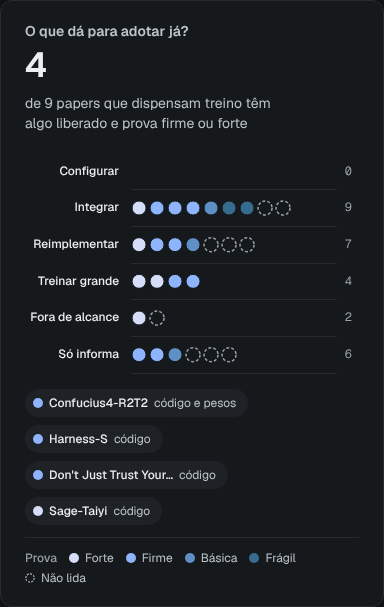
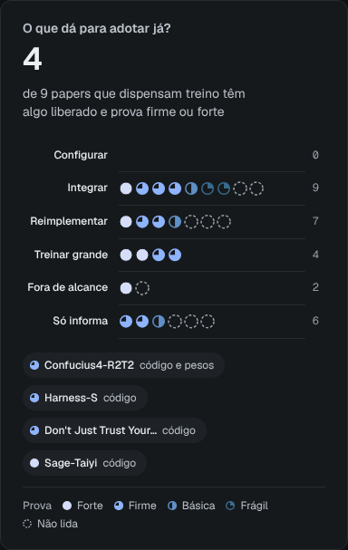

# Experimentos do redesenho

O que um experimento pode decidir foi prototipado em variantes com os dados
reais e medido antes de escolher. As variantes vivem no protótipo atrás de
parâmetros de endereço (`?arq=`, `?indice=`, `?dens=`, `?radar=`, `?g=`,
`?lentes=`, `?id=`). Depois deste registro o painel guarda só a forma escolhida;
para refazer os experimentos, use o commit `9d08bd8`, o último com todas as
variantes.

## E1. Arquitetura de navegação

Três arquiteturas, com as mesmas peças por dentro:

- **A Rolagem**: uma página só, com as seções em sequência e âncoras no topo.
- **B Vistas**: Papers, Panorama e Comparar.
- **C Perguntas**: Ler, Confiar, Adotar e Comparar.

Método igual ao do marco zero: cinco leitores simulados por arquitetura (três
no desktop a 1280 px e dois no celular a 360 px), que recebem só o roteiro
`medir/roteiro-uso.md`, o enunciado das tarefas e capturas de tela. Cada ação
devolve uma nova captura (`medir/sessao.mjs`, `medir/agir.mjs`). O tempo é a
estimativa KLM de `medir/pontuar.mjs`.

| | Desktop: certas | passos | tempo | 1º clique | Celular: certas | passos | tempo | 1º clique |
|---|---|---|---|---|---|---|---|---|
| Marco zero | 18/19 | 84 | 209 s | 17/19 | 6/8 | 54 | 121 s | 5/8 |
| A Rolagem | 19/19 | 46 | 122 s | 18/19 | 8/8 | 35 | 86 s | 8/8 |
| **B Vistas** | 18/19 | 38 | 98 s | 18/19 | 8/8 | 35 | 84 s | 7/8 |
| C Perguntas | 19/19 | 55 | 144 s | 18/19 | 8/8 | 39 | 96 s | 7/8 |

**Escolha: B.** É a mais rápida no desktop e empata com A no celular. O único
erro de B (T13) veio do gráfico de custo, e não da navegação. C é mais lenta e
os nomes das abas levaram a uma primeira vista errada (T17).

Por tarefa (certa · passos · segundos):

| Tarefa | Tela | Marco zero | A | B | C |
|---|---|---|---|---|---|
| T1 | 1280 | sim · 2 · 5,3 | sim · 1 · 2,7 | sim · 1 · 2,7 | sim · 1 · 2,7 |
| T2 | 1280 | sim · 13 · 30,9 | sim · 1 · 2,7 | sim · 1 · 2,7 | sim · 1 · 2,7 |
| T3 | 1280 | sim · 5 · 12,4 | sim · 3 · 9,5 | sim · 4 · 12,1 | sim · 3 · 9,5 |
| T4 | 1280 | sim · 0 · 0 | sim · 0 · 0 | sim · 0 · 0 | sim · 0 · 0 |
| T5 | 1280 | sim · 1 · 2,7 | sim · 0 · 0 | sim · 1 · 2 | sim · 1 · 2 |
| T6 | 1280 | sim · 3 · 6,9 | sim · 7 · 17,9 | sim · 1 · 2 | sim · 6 · 15,2 |
| T7 | 1280 | sim · 6 · 15,2 | sim · 1 · 2,7 | sim · 1 · 2,7 | sim · 1 · 2,7 |
| T8 | 1280 | sim · 5 · 12,6 | sim · 3 · 10,6 | sim · 1 · 2,7 | sim · 1 · 2,7 |
| T9 | 1280 | sim · 2 · 5,3 | sim · 2 · 5,3 | sim · 2 · 5,3 | sim · 3 · 8 |
| T10 | 1280 | sim · 3 · 8 | sim · 5 · 12,7 | sim · 4 · 11 | sim · 6 · 14,7 |
| T11 | 1280 | sim · 19 · 46,1 | sim · 6 · 14,2 | sim · 3 · 8 | sim · 6 · 15,3 |
| T12 | 1280 | **não** · 6 · 14,8 | sim · 4 · 9 | sim · 4 · 9 | sim · 3 · 7,1 |
| T13 | 1280 | sim · 2 · 5,3 | sim · 2 · 5,1 | **não** · 3 · 6,6 | sim · 3 · 7,6 |
| T14 | 1280 | sim · 1 · 2,7 | sim · 1 · 2,7 | sim · 2 · 4,6 | sim · 1 · 2,7 |
| T15 | 1280 | sim · 5 · 12,9 | sim · 2 · 6 | sim · 2 · 6 | sim · 5 · 14,5 |
| T16 | 1280 | sim · 3 · 7,8 | sim · 2 · 5,3 | sim · 2 · 4,6 | sim · 4 · 11,8 |
| T17 | 1280 | sim · 2 · 5,3 | sim · 2 · 5,3 | sim · 3 · 8 | sim · 6 · 14,5 |
| T18 | 1280 | sim · 2 · 5,1 | sim · 1 · 2,7 | sim · 0 · 0 | sim · 1 · 2,7 |
| T20 | 1280 | sim · 4 · 9,9 | sim · 3 · 8 | sim · 3 · 8 | sim · 3 · 8 |
| T1 | 360 | sim · 3 · 7,3 | sim · 2 · 5,3 | sim · 5 · 11,5 | sim · 2 · 5,3 |
| T3 | 360 | sim · 8 · 18,4 | sim · 7 · 18,6 | sim · 7 · 18,6 | sim · 4 · 12,1 |
| T5 | 360 | sim · 1 · 2,7 | sim · 1 · 2,7 | sim · 1 · 2,7 | sim · 1 · 2,7 |
| T6 | 360 | sim · 7 · 15 | sim · 13 · 30,2 | sim · 3 · 5,9 | sim · 3 · 5,9 |
| T11 | 360 | **não** · 16 · 34 | sim · 6 · 14,5 | sim · 13 · 30,3 | sim · 5 · 12,6 |
| T12 | 360 | **não** · 5 · 11,9 | sim · 2 · 4,6 | sim · 2 · 4,6 | sim · 7 · 16,5 |
| T15 | 360 | sim · 11 · 24,8 | sim · 0 · 0 | sim · 0 · 0 | sim · 13 · 30,7 |
| T20 | 360 | sim · 3 · 7,3 | sim · 4 · 10,6 | sim · 4 · 10,6 | sim · 4 · 10,6 |

### Limites desta medida

- Uma sessão por tarefa e condição. A diferença entre A e B está dentro do ruído; a entre o marco zero e qualquer protótipo, não.
- **Memória entre tarefas.** No celular, a T15 saiu com zero passos em A e B: o leitor respondeu com o que já tinha lido na lista em tarefas anteriores. Sem a T15, o celular fica em 96 s no marco zero contra 86 s (A), 84 s (B) e 65 s (C). No desktop, a T18 de B também saiu com zero passos; contando um clique para ela, B fica em cerca de 101 s. A medição final refaz o marco zero e o painel pronto com cada tarefa começando do zero.
- Um leitor de C no celular declarou ter lido o código do cliente `agir.mjs` (só o cliente de comandos, não o painel nem os dados).
- O primeiro clique de campos de busca aparecia sem nome no registro. `pontuar.mjs` passou a tratá-lo como "campo de busca" e os gabaritos de `primeiro-v1.json` foram completados.

### Achados das sessões e o que foi feito

| Achado | Onde | Situação |
|---|---|---|
| Zona "mais barato e melhor" pouco legível, rótulos de eixo irregulares | Custo | corrigido: eixo em potências de 2, pontos da zona maiores e com nome |
| Filtros cortados na barra do celular | Barra | corrigido: os quatro cabem numa linha, só ela fica presa no topo |
| Mediana do período invisível no índice | Índice | corrigido: divisor "Mediana do recorte" quando a ordem é votos ou ganho |
| Mediana invisível no paper aberto | Paper | corrigido: trilho com a mediana do recorte em Ganho, Prova e Adoção |
| Quadrados de resultado sem rótulo | Paper | corrigido: lista com benchmark, diferença e os dois valores |
| Menu longo para adicionar paper e salto de layout | Comparar | corrigido: menu com busca, posição estável |
| Tique da mediana sem legenda | Comparar | corrigido |
| Manchete sem evidência à mão | Paper | corrigido: atalho "trecho" nos sinais de manchete e limites |
| Filtro de Prova só aceita uma opção | Barra | decisão do Samuel (D8): protótipo de filtros somados em `?lentes=varias` |
| Falta uma frase em português sobre o problema | Paper | decisão do Samuel (D2): ver abaixo |

## E2. Teste de leitura

Oito leitores, dois por conjunto, recebem sete imagens e 21 perguntas
(`medir/leitura/perguntas.md`) e respondem só com o que cada imagem mostra.
As respostas são conferidas por `medir/leitura/pontuar.py`.

| Conjunto | Índice | Gráficos | Radar comparado | Certas | Papers inteiros na primeira tela |
|---|---|---|---|---|---|
| X | tabela, densidade média | forma a | sobreposto | 38/40 | 11 |
| Y | tabela, densidade compacta | forma b | lado a lado | 40/40 | 15 |
| Z | linhas | forma a | pontos | 38/40 | 10 |
| O, painel de antes | blocos | os de antes | o de antes | 27/40 | 30 |

Por grupo de perguntas (certas de cada conjunto, X · Y · Z · O):

| Grupo | X | Y | Z | O |
|---|---|---|---|---|
| Índice | 6/6 | 6/6 | 6/6 | 2/6 |
| Filtro ligado | 4/4 | 4/4 | 4/4 | 4/4 |
| Prova | 4/6 | 6/6 | 4/6 | 3/6 |
| Ganho | 6/6 | 6/6 | 6/6 | 4/6 |
| Adoção | 6/6 | 6/6 | 6/6 | 6/6 |
| Comparar | 8/8 | 8/8 | 8/8 | 6/8 |
| Comparar no celular | 4/4 | 4/4 | 4/4 | 2/4 |

O que se decidiu:

- **Índice em tabela de densidade média.** As três formas acertaram tudo; a tabela põe prova, ganho e adoção em colunas que se comparam de cima a baixo. O painel de antes mostra 30 blocos, mas eles não trazem esses fatos (2 de 6).
- **Prova deitada.** Na forma em pé, a pergunta "quantos papers têm prova forte" teve 0 de 4 respostas certas: dois pontos com 88 votos se encobriam. A forma deitada acertou, mas os leitores ainda reclamaram de sobreposição. O gráfico final é deitado, afasta os pontos que se tocariam (enxame determinístico em `tema.js`), escreve a contagem de cada nível no eixo e o valor da mediana na linha.
- **Ganho em ponto com faixa, adoção em pontos por nível, radar sobreposto.** Todas as formas acertaram tudo; ficam as mais compactas. No radar em pontos os marcadores sobre a linha da mediana eram ambíguos no celular.
- **Filtros em menus sempre à vista.** Todos identificaram o filtro ligado e o botão de limpar.

Queixas que não viraram erro e seguem para as rodadas: pontos Forte e Firme
parecidos em tamanho pequeno; barras da adoção sem número na forma b.

## E3. Identidades

Três identidades trocam só famílias de fonte, raios e o bloco de cor
(`?id=periodico`, `?id=oficina`; sem parâmetro, Instrumento). As rampas de
prova e o trio de comparação foram buscados em OKLCH com simulação de
daltonismo. As três passam nas mesmas medidas, nos dois temas:

| Medida | Instrumento | Periódico | Oficina |
|---|---|---|---|
| Contraste, 76 pares de tokens | 0 abaixo do mínimo; pior texto 5,35:1 | 0; pior texto 5,41:1 | 0; pior texto 5,35:1 |
| Daltonismo, menor ΔE2000 entre categorias | 10 ou mais em todas as visões | 10 ou mais | 10 ou mais |
| axe, 24 estados | 0 violações | 0 | 0 |
| Casos extremos, 54 combinações | 0 quebras | 0 | 0 |

A escolha entre elas é do Samuel.

## E4. Marca de prova: só cor ou cor mais preenchimento

Três dos quatro críticos da primeira rodada disseram que os quatro azuis da
prova se confundem num ponto de 10 px (ver `06-rodadas.md`). A dúvida é de
leitura, então foi medida.

**Variantes.** `cor`: disco cheio, o nível está só na cor (como estava).
`cheio`: a mesma cor e, além dela, o disco enche conforme a prova: Forte
inteiro, Firme três quartos, Básica metade, Frágil um quarto. Não lida continua
anel tracejado nas duas.

**Método.** Um leitor simulado por variante e condição, sem ver a outra
variante. Cada leitor recebe só duas imagens (o quadro de adoção e o de ganho)
e responde 30 itens: 15 contagens de pontos por nível em três linhas do quadro
de adoção e o nível de 15 papers no quadro de ganho. Pode responder "não sei".
Roteiro em `painel-v2/medir/marca/roteiro.txt`.

| Passada | Condições | Só cor | Cor mais preenchimento |
|---|---|---|---|
| 1, imagens em dobro de resolução | claro, escuro, deuteranopia, celular | 120 de 120 | 120 de 120 |
| 2, no tamanho real da tela | celular, deuteranopia, escuro | 86 de 90 | 90 de 90 |
| Total | 14 leitores | 206 de 210 | 210 de 210 |

Os quatro erros da cor sozinha foram no tema escuro, no tamanho real, no quadro
de adoção: Forte e Firme trocados em duas linhas. Nenhum leitor respondeu "não
sei". Nos comentários, quem leu só a cor disse que Forte contra Firme e Firme
contra Básica só se separam com um vizinho para comparar; quem leu o
preenchimento disse que Forte, Não lida e Frágil são imediatos e que a dúvida
que sobra é Firme contra Básica quando uma linha cruza o ponto.




**Recomendação, já aplicada.** A marca com preenchimento acertou tudo onde a
cor sozinha errou, não foi pior em nenhuma condição e tira a dependência da cor
como único sinal. A linha do zero e a faixa do pior ao melhor resultado
passaram para trás do ponto no quadro de ganho, que era a queixa que sobrou.

D4 diz que os pontos têm uma codificação só, a solidez, sem formas nem
preenchimentos para entrega, abertura ou esforço. O preenchimento repete a
solidez num segundo canal e não codifica outra variável. Mesmo assim D4 é
decisão deliberada, então a troca entra na lista do Samuel (décima escolha),
com as duas formas lado a lado. Voltar à cor sozinha é trocar o padrão de
`pontoProva` em `lib/tema.js` e tirar quatro linhas de `app.css`.

**Limites.** Um leitor por célula: a diferença é de 4 respostas em 210, toda
numa célula. Vale como desempate entre duas formas que passam nas outras
medidas, não como tamanho de efeito. Leitores simulados leem a imagem melhor
que um olho apressado no celular; por isso a segunda passada foi no tamanho
real.

Respostas brutas: `experimentos/marca.json`. As duas variantes existem lado a
lado no commit `d3e21a3` (`?marca=cor` e `?marca=cheio`).

## Decisões que ficam com o Samuel

Apresentadas lado a lado, com capturas, em
https://claude.ai/artifact/MoUz7mno5DbwCoBaSdmm79 (2026-11-16):

1. Identidade visual: Instrumento, Periódico ou Oficina.
2. Tipografia de display: a da identidade, Geist, Newsreader ou Bricolage Grotesque.
3. Tom de voz: direto, técnico ou conversado.
4. Vocabulário dos seis eixos: um nome por conceito ou os nomes do protótipo v3.
5. A pergunta que vem primeiro: ler hoje, sólido ou hype, adotar já.
6. Quadros: ficam os sete, sai o de custo (cobre 5 de 28 papers) ou entra um de abertura.
7. Tema padrão: seguir o sistema, claro ou escuro.
8. Frase do problema escrita pelo modelo (D2): em 17 de 28 papers ela só repete palavras do título.
9. Filtros combinados (D8): um por vez ou somados. No celular a T11 custou 13 passos com um filtro por vez.

Acrescentadas depois da primeira rodada de crítica (`06-rodadas.md`):

10. Marca de prova (D4): cor mais preenchimento, como o E4 recomenda, ou só cor.
11. Escala da amplitude no radar (D6 e D12): a conta do Python é `20 × benchmarks`
    com teto em 100, então 5 e 9 benchmarks caem no mesmo vértice. Opções: manter,
    escala logarítmica fixa (1, 3, 5, 9 e 16 benchmarks viram 24, 49, 63, 81 e 100)
    ou escala pelo maior do período.
12. Miniatura do radar na lista (D6): três críticos não conseguiram ler a forma em
    32 px. Hoje ela aparece só onde há largura (some no celular). Opções: manter
    assim, tirar, ou trocar pela marca de prova.

## Como refazer

```bash
cd painel-v2 && npx vite build --outDir /tmp/proto --emptyOutDir && cp ../relatorios/painel-v2/dados.json /tmp/proto/
node medir/sessao.mjs --dir /tmp/proto --porta 4921 --largura 1280 --registro medir/saida/e1-b/uso-4921.jsonl --inicio "?arq=b"
node medir/pontuar.mjs --saida medir/saida/e1-b --primeiro medir/primeiro-v1.json
node medir/leitura/capturar.mjs --proto /tmp/proto --base ../relatorios/painel-v2 --saida medir/saida/leitura
python3 medir/leitura/pontuar.py medir/saida/leitura
node medir/contraste.mjs --dir /tmp/proto --id periodico
node medir/daltonismo.mjs --dir /tmp/proto --paletas medir/paletas-v1.json --id oficina
# E4, a partir do commit d3e21a3 (que tem as duas marcas):
node medir/marca/estimulos.mjs /tmp/proto /tmp/marca 1
node medir/marca/pontuar.mjs /tmp/marca-respostas celular,deuteranopia,escuro
```

Resultados brutos: `docs/painel-v2-redesenho/experimentos/`.
